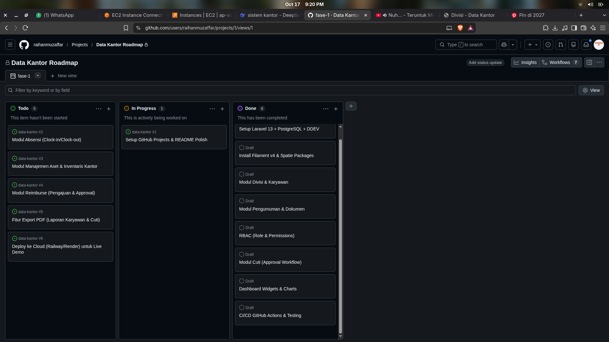

# Sistem Data Kantor

[](https://github.com/raihanmuzaffar/data-kantor/actions/workflows/ci.yml)
[](https://laravel.com)
[](https://filamentphp.com)
[](https://www.postgresql.org)

Sistem informasi manajemen kantor berbasis **Laravel 13** + **Filament v4** + **PostgreSQL**. 
Dibangun sebagai *project portfolio* yang mendemonstrasikan praktik *software engineering* modern: arsitektur bersih, RBAC (Role-Based Access Control), UI Dashboard yang responsif, dan otomatisasi CI/CD.

> **Status:** Fase 1 & 2 Selesai. Siap untuk demo.

## ✨ Fitur Utama

- **Role & Permission (RBAC):** 4 level akses (`super_admin`, `admin`, `manajer`, `karyawan`) dengan *Policy* yang ketat di level UI maupun backend.
- **Modul Data Master:** Manajemen Divisi dan Data Karyawan (dilengkapi upload dokumen & relasi antar tabel).
- **Modul Komunikasi:** Pengumuman internal dengan fitur prioritas, penargetan divisi tertentu, dan *Rich Text Editor*.
- **Dashboard Interaktif:** Statistik *real-time* dengan visualisasi *Sparkline*, *Horizontal Bar Chart*, dan *Doughnut Chart* untuk komposisi status karyawan.
- **Pengujian & Kualitas Kode:** Feature testing menggunakan PHPUnit untuk memastikan keamanan RBAC berjalan, serta *Code Style* otomatis dengan Laravel Pint.

## 🛠 Tech Stack

- **Backend:** Laravel 13, PHP 8.3
- **Admin Panel:** Filament v4 (Livewire)
- **Database:** PostgreSQL 16
- **Autentikasi & Otorisasi:** Spatie Laravel Permission
- **Media & Log:** Spatie Media Library, Spatie Activity Log
- **Testing & QA:** PHPUnit, Laravel Pint
- **DevOps:** DDEV (Docker), GitHub Actions (CI)


## 📊 Project Management

Kami melacak setiap fitur dan perbaikan menggunakan GitHub Projects. 


## 🚀 Cara Menjalankan

Prasyarat: **Docker** dan **DDEV** sudah terinstall di sistem Anda.

```bash
git clone https://github.com/raihanmuzaffar/data-kantor.git
cd data-kantor

ddev start
ddev composer install
cp .env.example .env
ddev artisan key:generate
ddev artisan migrate --seed
ddev launch
